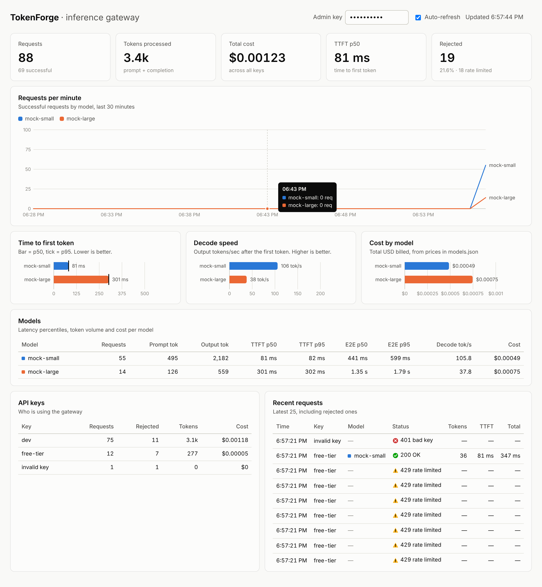

# TokenForge — a mini inference gateway

An OpenAI-compatible API that sits in front of LLMs, like a tiny version of
Jarvislabs Token Factory, OpenRouter or Together AI. It handles API keys, rate
limits, streaming, usage metering and cost tracking, and comes with a benchmark tool.

Works on a laptop with **no GPU** (mock models). Later you point it at a real
vLLM server on a rented GPU.

```
client ──► TokenForge gateway ──► mock model     (laptop, free)
           auth · rate limit  └─► vLLM / SGLang   (GPU, Phase 4)
           metering · cost    └─► any OpenAI-compatible API
```

New to this? Start with **[docs/learn.html](docs/learn.html)**, a step-by-step visual guide
(download it and open it in your browser).

## Quick start

```bash
pip install -r requirements.txt
pytest -q                                   # 8 tests should pass
uvicorn gateway.main:app --port 9000        # start the gateway
```

In a second terminal:

```bash
curl localhost:9000/v1/chat/completions -H "Authorization: Bearer sk-dev-123" \
  -H "Content-Type: application/json" \
  -d '{"model":"mock-small","messages":[{"role":"user","content":"hi"}]}'

python -m bench.benchmark --model mock-small --requests 40 --concurrency 8
curl localhost:9000/v1/usage -H "Authorization: Bearer sk-dev-123"
```

## Dashboard

Open **http://localhost:9000/dashboard** while the gateway is running. It refreshes
every 3 seconds and shows requests per minute, TTFT p50/p95, decode speed, cost per
model, usage per API key, and a live log of recent requests, including rate-limited
and rejected ones. It follows your system's light/dark setting.



The dashboard reads `GET /v1/stats`, which requires an API key with `"admin": true`
in `models.json` (`sk-dev-123` by default). Run the benchmark in another terminal to
watch the charts move.

It also works with the official `openai` Python SDK:

```python
from openai import OpenAI
client = OpenAI(base_url="http://localhost:9000/v1", api_key="sk-dev-123")
print(client.chat.completions.create(model="mock-small",
      messages=[{"role": "user", "content": "hi"}]).choices[0].message.content)
```

## Layout

| File | What it does |
|---|---|
| `gateway/main.py` | FastAPI app: `/v1/chat/completions` (streaming + non-streaming), `/v1/models`, `/v1/usage` |
| `gateway/backends.py` | `MockBackend` (simulates TTFT + decode speed) and `OpenAIBackend` (proxies vLLM, etc.) |
| `gateway/ratelimit.py` | Token-bucket rate limiter per API key |
| `gateway/usage.py` | SQLite usage log + cost calculation |
| `models.json` | Model registry, prices, API keys |
| `gateway/static/dashboard.html` | Live dashboard (plain HTML + SVG, no build step) |
| `bench/benchmark.py` | Load tester: TTFT, TPOT, p50/p95 latency, throughput |

See **ROADMAP.md** for what to build next and what each phase teaches.
